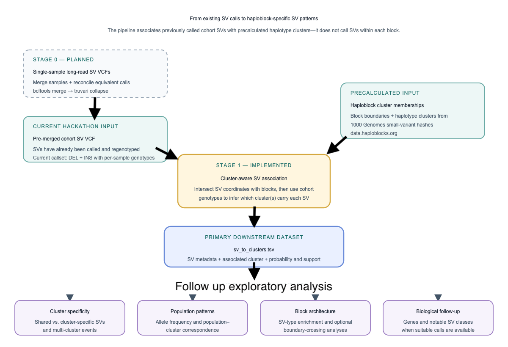

> Structural Variants Hackathon at Baylor College of Medicine, August 25-28, 2026

<h1 align="center">Haploblock SV</h1>

<p align="center">
  
 
  <h3 align="center">A pipeline for implicit analysis of structural variants within haploblocks.</h3>
</p>


# Overview

Haploblock SV asks when a local, SNV-derived haplotype cluster can stand in for direct structural-variant (SV) genotyping, and when an SV carries information that the cluster misses. It builds on [haploblocks.org](https://haploblocks.org), which defined haploblock boundaries and clustered 1000 Genomes haplotypes within each block from small variants only. The pipeline takes a cohort SV VCF, probabilistically assigns each SV to the haploblock clusters that carry it (VCF phase and cluster `hap0`/`hap1` labels are independent, so heterozygotes are resolved with an EM model), and then classifies SVs as common or population-specific, tests SV-type enrichment per block, tests cluster–SV association within populations, audits how well each cluster represents each SV, annotates candidate genes, and writes a summary report. All analyses are associations meant to prioritize loci, not causal or functional claims.



# Installation

Python 3.9 or newer. All stages run on CPU; no GPU is needed.

```bash
python -m venv .venv
source .venv/bin/activate
pip install -r requirements.txt            # Stages 1-8 and the test suite
pip install -r requirements-report.txt     # optional: Stage 9 report (adds mistune, openai)
```

Stage 0 also needs [bcftools](https://samtools.github.io/bcftools/) and [truvari](https://github.com/ACEnglish/truvari) on `PATH`, e.g.:

```bash
conda install -c bioconda -c conda-forge bcftools truvari
```

Check the installation by running the unit tests and a synthetic end-to-end run of the whole chain:

```bash
pytest pipeline/tests
python pipeline/stage9_report.py --test
```

# Usage

Each stage is one script in `pipeline/`. Every stage after Stage 1 reads the `config.yaml` written by the stage before it and writes its own `config.yaml` (inputs plus new outputs) into its `--out-dir`, so stages can be rerun, skipped or replaced independently. Every script has `--help` and a `--test` flag that runs that stage, plus the upstream stages it needs, on a tiny synthetic dataset in a temporary directory (a few seconds, no downloads) and exits. The commands below reproduce the chromosome 21 run shown in [Results](#results); omit `--chroms` to process chr1-22 and chrX.

**Stage 0 — merge single-sample VCFs (optional).** Merges a list of single-sample SV VCFs with `bcftools merge` and reconciles equivalent records with `truvari collapse`; skip it if you already have a cohort VCF. `--test` requires bcftools and truvari.

```bash
python pipeline/stage0_merge_vcfs.py --vcf-list vcf_list.txt --out-dir stage0_output --threads 4
```

**Stage 1 — cluster-aware preprocessing.** Splits the cohort VCF into per-chromosome genotype tables, downloads haploblock cluster memberships, sample metadata and a GTF (or uses local copies via `--cluster-root`, `--sample-metadata`, `--gtf`), and infers SV-to-cluster associations.

```bash
python pipeline/stage1_cluster_aware.py --vcf input/1kgp_ont_cohort.postfilter.full.vcf.gz \
    --chroms chr21 --out-dir stage1_output --threads 8
```

**Stage 2 — boundary classification (optional).** Classifies each SV as within a block, outside all blocks, or crossing a boundary, and flags SVs near a boundary.

```bash
python pipeline/stage2_boundary_classification.py --config stage1_output/config.yaml --out-dir stage2_output
```

**Stage 4 — population allele-frequency classification.** Labels each SV as common, population-specific or other from per-population allele frequencies; `--plots` adds per-chromosome figures.

```bash
python pipeline/stage4_classify_af.py --config stage1_output/config.yaml --out-dir stage4_output --plots
```

**Stage 5 — SV-type enrichment (optional).** Tests whether a haploblock holds more or fewer SVs of a type than expected from its length (Poisson test, Benjamini–Hochberg).

```bash
python pipeline/stage5_type_enrichment.py --config stage1_output/config.yaml --out-dir stage5_output
```

**Stage 6 — population-conditioned cluster association.** Tests whether carrying a cluster predicts carrying the SV within populations, using within-population permutations; lower `--permutations`/`--refinement-permutations` for a quick run.

```bash
python pipeline/stage6_cluster_association.py --config stage4_output/config.yaml --out-dir stage6_output --threads 8
```

**Stage 7 — hash representation audit.** Measures how concentrated each SV's carriers are across clusters and how pure each cluster is for carriage, and labels each SV–block pair (e.g. `hash_tag_candidate`, `hash_subdivision_candidate`); also writes an SV PCA for QC.

```bash
python pipeline/stage7_hash_representation.py --config stage6_output/config.yaml --out-dir stage7_output --threads 4
```

**Stage 8 — consequence-aware annotation.** Adds SV-type-aware gene, exon and breakpoint consequences and call-quality labels to the Stage 6/7 candidates.

```bash
python pipeline/stage8_candidate_annotation.py --config stage7_output/config.yaml --out-dir stage8_output
```

**Stage 9 — report (optional).** Summarizes Stages 5–8 into `report.md`/`report.html` with figures; only when you opt in with `--agent auto` (and `OPENAI_API_KEY` is set) or `--agent required` does it send anything to OpenAI, adding a plain-language interpretation generated from the compact `report_facts.json` only.

```bash
python pipeline/stage9_report.py --config stage5_output/config.yaml --config stage8_output/config.yaml \
    --out-dir stage9_output --agent off
```

Output fields, thresholds and methods for each stage are documented in [docs/](docs/README.md).

# Data

| Data | Source | How it is obtained |
|---|---|---|
| Haploblock clusters (genomic hashes) | [data.haploblocks.org](https://data.haploblocks.org) | Downloaded by Stage 1 from `https://data.haploblocks.org/haploblock_hashes/1000G/<chrom>/clusters/` and cached in `stage1_output/_intermediate/`; or pass `--cluster-root` with local files. |
| Cohort SV VCF used in Results | `1kgp_ont_cohort.postfilter.full.vcf.gz`, a previously merged 1000 Genomes ONT SV callset (402 samples; Sniffles → `bcftools merge` → `truvari collapse` → kanpig) | Not distributed with this repository; place it under `input/` (git-ignored) or build a cohort VCF with Stage 0. |
| Long-read 1KGP SV calls | [1000G ONT Sniffles v2.6.2 calls](https://s3.amazonaws.com/1000g-ont/index.html?prefix=PROCESSED_DATA/ALIGNED_TO_HG38/SNIFFLES_v2.6.2/) | Download single-sample VCFs and list their paths in a Stage 0 manifest. |
| Sample metadata | [1kGP_LRSC_500_ONT_Metadata.tsv](https://s3.amazonaws.com/1000g-ont/PROCESSED_DATA/1kGP_LRSC_500_ONT_Metadata.tsv) | Downloaded by Stage 1 unless `--sample-metadata` is given. |
| Gene annotation | [Ensembl GRCh38 release 115 GTF](https://ftp.ensembl.org/pub/release-115/gtf/homo_sapiens/) | Downloaded by Stage 1 unless `--gtf` is given. |
| Other SV resources considered | [HGSVC](https://www.internationalgenome.org/human-genome-structural-variation-consortium/); 1KGP haplotype-resolved SVs, dbVar nstd152 ([Chaisson et al. 2019](https://www.nature.com/articles/s41467-018-08148-z)) | Not used by the current pipeline. |

Input formats:

- **Cohort VCF** — GRCh38 VCF/VCF.GZ (bgzipped + tabix-indexed is fastest) with `INFO/SVTYPE`, `INFO/END` and/or `INFO/SVLEN`, and a per-sample `GT`. `GM12345` sample IDs are renamed to `NA12345` to match 1000 Genomes metadata.
- **Cluster files** — one file per haploblock named `<chrom>_<start>-<end>_cluster.tsv`, two tab-separated columns without header: `cluster_id` and a haplotype ID `<sample>_<chrom>_region_<start>-<end>_hap<0|1>`. A local `--cluster-root` uses the layout `<root>/<chrom>/<files>`.
- **Sample metadata** — TSV with `sample_id` and `population` (optional `superpopulation`); the 1000 Genomes ONT column names `NHGRI_ID`, `SubPopulation`, `SuperPopulation` are recognised.
- **Stage 0 manifest** — text file with one single-sample VCF path per line; `#` comments allowed.
- **Outputs** — tab-separated tables with a shared leading schema (`sv_record_id`, `sv_id`, `chrom`, `start`, `end`, `sv_type`, `length`, `filter`, `imprecise`; 0-based half-open coordinates) plus one `config.yaml` per stage registering every output path.

Expected layout when running from the repository root:

```text
input/1kgp_ont_cohort.postfilter.full.vcf.gz(.tbi)   # your cohort VCF (git-ignored)
stage1_output/ ... stage9_output/                    # one directory per stage (git-ignored)
```


# Results
The current prototype uses 1kgp_ont_cohort.postfilter.full.vcf.gz , a previously merged structural variant callset derived from the 1000 Genome Project Oxford Nanopore Technologies (ONT) cohort, comprising a total of 402 samples. For this initial demonstration, we focused on chromosome 21 to confirm successful integration of the pipeline, and assess the overall analytical results. 

The purpose of Stage 2 is to classify SVs based on their positional relationship to haploblock regions. For this demonstration, the input VCF contained 83,159 unique SV records, which were categorized into three classes

| Position class | Count | Definition |
|---|---|---|
|within block|60,367|The SV overlaps exactly one haploblock.|
|outside block|22,760|The SV overlaps exactly no haploblock.|
|boundary crossing|22|The SV overlaps two or more haploblocks.|

These results provide a quantification on how SVs are distributed relative to haploblock regions. In addition to their positional classification, 17,222 SVs were classified as near boundary, indication that they occur close to a haploblock boundary, whereas 65,927 Svs were classified as not near boundary. 

The purpose of Stage 4 is to classify each structural variant (SV) according to its allele frequency (AF) distribution across population subgroups within the cohort and to associate these classifications with haploblocks as shown in Table 1. 

Table 1. Chromosome 21 classification based on the cohor population AF
| Position class | Count | Definiton| 
|---|---|---|
|common|5,224|AF meets the presence threshold in at least two subpopulations|
|population_specific|1,657|AF meets it in exactly one population and is below the absence threshold in all other populations with data.|
|other|76,268|Insufficient data, rare/absent, or an intermediate pattern not captured by the two classes..|


Figure 1-stage4: The figure illustrates the distribution of structural variant (SV) composition across haploblocks on chromosome 21, based on allele frequencies observed in the study cohort. 

The population-specific variants are distributed across many subpopulations and haploblocks with the largest counts associated with PEL, YRI, PJL, LWK and ACB.


Figure 2-stage4: Top 30 haplablocks ranked by the number of unique structural variants (SVs) observed exclusively within each subpopulation. Each unique SV is counted once per subpopulation, provided that at least two samples carry the SV.

Stage 5 (Review of data in progress)

Stage 6 (Review of data in progress)


# Contributors

The scientific idea, aim and scope of this project were introduced by:

- Jędrzej Kubica jedrzej.kubica@univ-grenoble-alpes.fr 
- Lynn Ly lynn.ly@nanoporetech.com
- Maria Fernanda Cardenas maria.cardenas@stjude.org
- Linh Nguyen nguyen.linh.1010@ku.edu

The technology was created by agentic AI provided by Claude, ChatGPT and Codex.

# Acknowledgements

Special thank you to the hackathon organizers!

The computing resources for this project were sponsored by [DNAnexus](https://www.dnanexus.com).


# References

1. Kubica, J., Jethwani, H., Banecki, K. H., Moldes, M., Plewczynski, D., & Busby, B. (2025). Decoding complex genotype-phenotype interactions by discretizing the genome. https://doi.org/10.37044/osf.io/xhkc3_v1
2. https://haploblocks.org
3. https://data.haploblocks.org
4. International HapMap Consortium (2005). A haplotype map of the human genome. Nature, 437(7063), 1299–1320. https://doi.org/10.1038/nature04226
5. Claussnitzer, M. et al. (2020). A brief history of human disease genetics. Nature, 577(7789), 179–189. https://doi.org/10.1038/s41586-019-1879-7
6. The 1000 Genomes Project Consortium (2015). A global reference for human genetic variation. Nature, 526(7571), 68–74. https://doi.org/10.1038/nature15393
